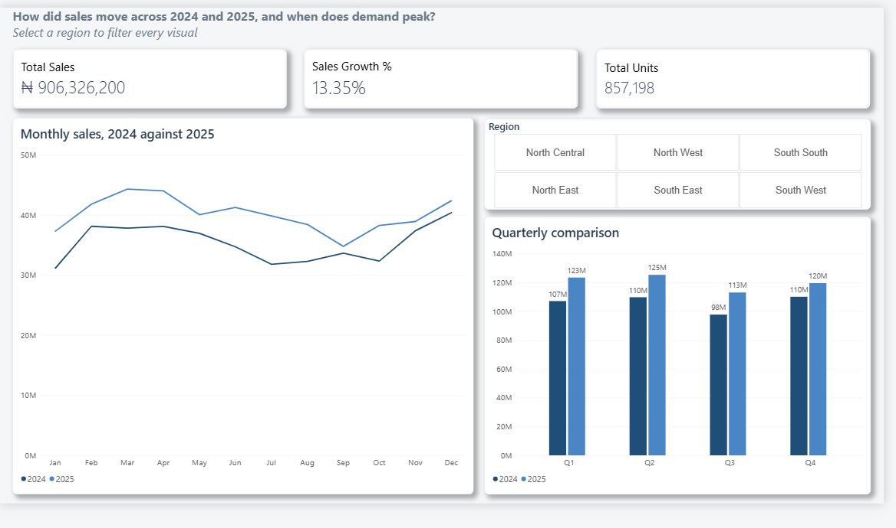
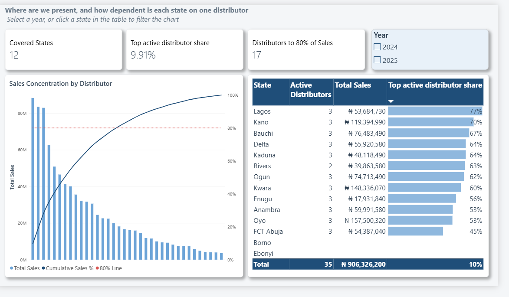
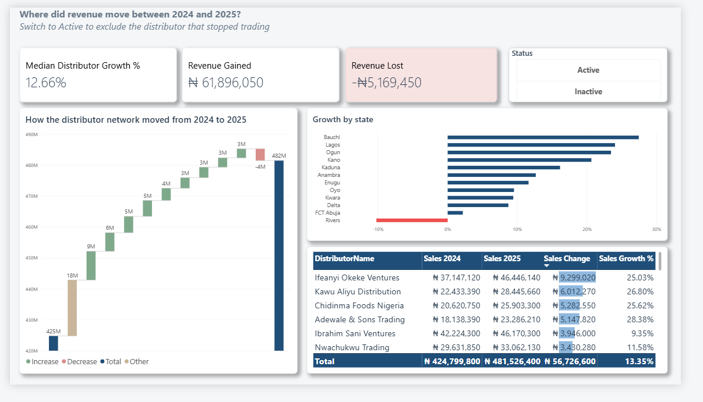

# Adun Foods: distributor network analysis

A Power BI case study on a synthetic Nigerian distributor network. Three dashboards, each answering one business question, built from generated data through to a report that can be opened and checked.

## The dashboards

### 1. Sales Overview
*How did sales move across 2024 and 2025, and when does demand peak?*



### 2. Coverage and Concentration
*Where are we present, and how dependent is each state on one distributor?*



### 3. Revenue Movement
*Where did revenue move between 2024 and 2025?*



## What the analysis found

- Sales grew 13.35%, from ₦424.8M to ₦481.5M, with every quarter of 2025 ahead of 2024.
- Nationally the network looks safe. The largest distributor holds 9.91% of sales and seventeen of thirty-six reach 80%.
- Locally it is not. One distributor holds 77% of Lagos, 70% of Kano and 67% of Bauchi.
- Thirty of thirty-six distributors grew. Of the ₦5.17M lost, ₦3.79M came from the single distributor that stopped trading.
- Rivers is the only state that declined, and it is the state that lost that distributor.

Full working, including the caveats, is in [docs/ANALYSIS.md](docs/ANALYSIS.md).

## Repository contents

| Path | Contents |
| --- | --- |
| `data/` | Five CSVs, plus the same tables as one Excel workbook |
| `scripts/generate_data.py` | Builds the dataset from a fixed seed |
| `scripts/analyse.py` | Reproduces every figure on the dashboards |
| `docs/SCOPE.md` | Questions, assumptions, measure definitions, limitations |
| `docs/ANALYSIS.md` | Findings with caveats |
| `docs/DATA_DICTIONARY.md` | Every column and relationship |
| `dashboards/` | Captures from Power BI Desktop |
| `theme/` | The report theme |
| `outputs/key_metrics.json` | Machine-readable version of every figure |

## Reproducing it

```bash
pip install -r requirements.txt
python scripts/generate_data.py   # rewrites data/, byte for byte
python scripts/analyse.py         # prints and writes every dashboard figure
```

`analyse.py` prints the headline numbers, so the dashboards can be checked against the data in one command:

```
Data quality     nulls=0 orphans=0 mismatches=0 sales-before-onboarding=0
Page 1           total NGN 906,326,200  growth 13.35%  peak 2025-03
Page 2           12/14 states covered  largest 9.91%  17 to 80%  HHI 513.5
Page 3           gained NGN 61,896,050  lost NGN -5,169,450  net NGN 56,726,600
```

## Building the report yourself

1. In Power BI Desktop, **Get Data > Excel Workbook** and select `data/AdunFoods_data.xlsx`. Load all five sheets as tables.
2. Sort `Month` by `MonthNumber` and `Quarter` by a `QUARTER(Dates[Date])` column.
3. Check the four relationships listed in the data dictionary, all single-direction and many to one.
4. Add the measures from `docs/SCOPE.md`.
5. Apply `theme/AdunFoods_Theme.json` via **View > Themes > Browse for themes**.

## A note on the data

Every figure is synthetic, generated with a fixed seed. The patterns come from the generator, so nothing here describes real Nigerian trade. What the project demonstrates is the path from raw data to a defensible answer, including the places where an obvious chart would have been misleading. `docs/SCOPE.md` explains why the `Tier` column appears in the data and on none of the dashboards.
